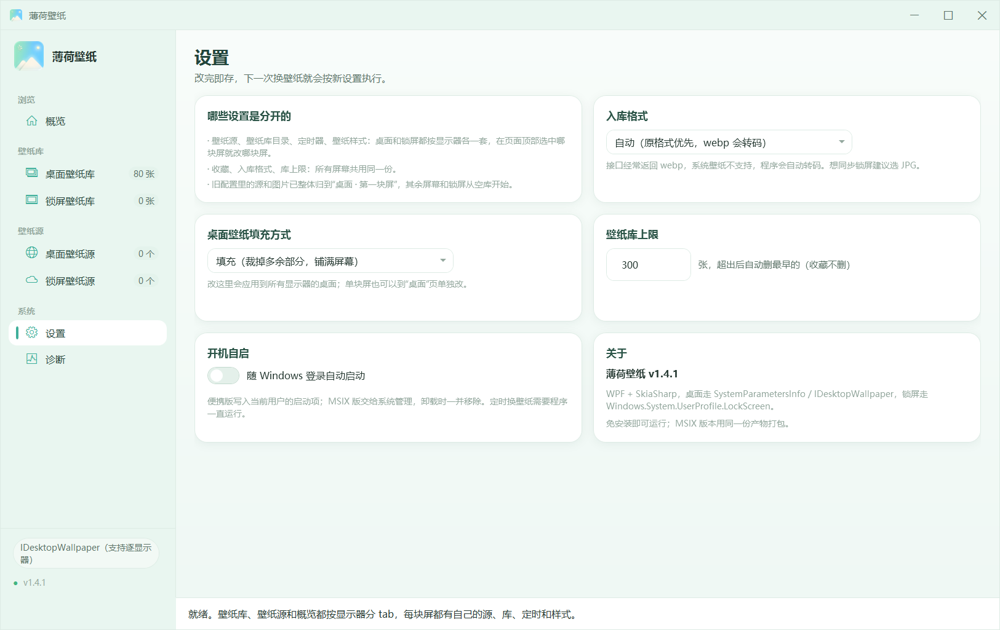

# 薄荷壁纸 · MintWall

一个给 Windows 用的轻量壁纸工具：**桌面和锁屏分开管理，每块显示器各自一套壁纸源、壁纸库和定时规则**。界面按系统语言显示名字（中文「薄荷壁纸」，English「MintWall」）。

基于 .NET 8 + WPF，自包含发布，不需要额外装运行时。

## 界面预览

概览页：每块屏的桌面 / 锁屏预览、换图按钮和定时卡片放在一起，一屏看完。


设置页：入库格式、桌面填充方式、壁纸库上限与开机自启。



## 功能

### 桌面 / 锁屏 / 多显示器
- 桌面与锁屏是两个独立目标，各自维护壁纸源、壁纸库、定时和填充方式。
- 每块显示器一份配置，在页面顶部切换显示器 tab，互不影响。
- 桌面优先走 `IDesktopWallpaper` 逐显示器下发；系统不支持时自动退化为 `SystemParametersInfo` 整屏统一。
- 填充方式：填充、适应、拉伸、居中、平铺、跨屏。
- 换桌面壁纸时可以顺带把锁屏一起换掉。

### 壁纸源
- 图片直链、JSON 接口（自动探测字段）、必应每日壁纸。
- 每个源可以单独设置请求头、启用/停用、抓图后是否自动存入壁纸库。
- 「换一张」从启用的源里随机取图；没有配置任何源时用必应每日壁纸兜底。
- 接口诊断：显示跳转链路、Content-Type、图片尺寸和最终入库格式。

### 壁纸库
- 桌面库、锁屏库按显示器分开存放，也可以直接指向自己的相册目录（含子文件夹）。
- 收藏、按文件名筛选、只看收藏、缩略图、导入本地图片。
- 库上限可调，超出后自动清理最早的（收藏不删）。

### 定时
- 桌面按固定间隔换图。
- 锁屏定时**只在会话锁定后开始计时**，解锁立即暂停，下次锁定重新计时。
- 开启开机自启时，点 × 会退出界面，由一个无窗口的轻量后台进程接管定时（不加载 WPF，空闲占用从约 200MB 降到几十 MB）；再点程序图标恢复窗口，后台进程自动让位。登录自启直接进后台进程，不弹窗口。
- 未开启开机自启时，点 × 直接退出程序，定时随之停止。

### 安装与卸载
- 提供 MSIX 安装包、便携 zip、单文件 exe 三种形态。
- MSIX 版数据全部放在系统包容器里，**在开始菜单/设置里右键卸载即可清掉**设置、壁纸库、缓存、缩略图等默认数据；用户自选的库目录和保存目录不会被删除。
- MSIX 开机自启使用系统 `startupTask`，出现在「设置 → 应用 → 启动」，卸载时由系统一并移除。
- 便携/单文件版可用 `MintWall.exe uninstall` 清理数据。

## 下载

前往 [Releases](https://github.com/ShmilyStar/MintWall/releases/latest) 下载：

| 资产 | 说明 |
| --- | --- |
| `MintWall_x.y.z_installer_x64.zip` | 一键安装包，解压后双击 `Install.cmd`（含自签证书） |
| `MintWall_x.y.z_x64.msix` | 原始安装包，需先信任 `packaging/MintWall.cer` |
| `MintWall_x.y.z_portable_x64.zip` | 免安装便携版，解压直接运行 `MintWall.exe` |
| `MintWall_x.y.z_win-x64.exe` | 单文件版，双击即用 |

> MSIX 使用自签名证书，首次安装需要信任包内证书；`Install.cmd` 会自动完成。

## 命令行

不开窗口也能用，适合脚本和计划任务：

```text
MintWall.exe probe <url> [--kind auto|image|json] [--field data.url] [--headers "Key: Value"] [--apply] [--target desktop|lock] [--screen 1] [--monitor all|<id>] [--style fill]
    诊断接口：打印跳转、Content-Type、尺寸、入库格式。加 --apply 会真的换壁纸。

MintWall.exe set <图片路径> [--target desktop|lock] [--screen 1] [--monitor all|<id>] [--style fill|fit|stretch|center|tile|span]
    把本地图片导入该屏的壁纸库并设为壁纸。

MintWall.exe auto [--target desktop|lock] [--screen 1] [--source <名称或ID>]
    从该屏启用的源里随机取一张并应用，等同定时任务执行的一次动作。

MintWall.exe list [--target desktop|lock]
    列出每块屏的壁纸源、壁纸库、保存位置与显示器状态。

MintWall.exe uninstall
    删除默认数据目录（设置、壁纸库、缓存、缩略图、保存归档）和开机自启；
    用户自选的壁纸库/保存目录保持不动。
```

`--target` 缺省 `desktop`；`--screen` 可选序号、名称或 id 片段，缺省第 1 块屏。

## 数据存放

| 版本 | 目录 |
| --- | --- |
| MSIX | `%LOCALAPPDATA%\Packages\MintWall.Desktop_cjhz37xas16f6\LocalState\MintWall` |
| 便携 / 单文件 | `%LOCALAPPDATA%\MintWall` |

```text
MintWall/
├─ settings.json        配置（源、定时、样式、路径）
├─ wallpapers/          桌面壁纸库（内置目录，按显示器分）
├─ wallpapers-lock/     锁屏壁纸库
├─ cache/               抓取缓存
├─ thumbs/              缩略图
├─ saved/               源自动保存归档
└─ worker.log           后台进程日志（滚动，不超过 512KB）
```

用户自选的壁纸库/保存目录不在程序管理范围内，卸载时不会删除。

## 从源码构建

需要 Windows x64 与 .NET 8 SDK（仓库不依赖 Visual Studio 或系统级 Windows SDK）。

```powershell
# 构建并打包 MSIX + 便携 zip（首次会自动下载 makeappx/signtool）
powershell -ExecutionPolicy Bypass -File scripts\build.ps1 -Version 1.4.1

# 跳过 MSIX，只生成便携版
powershell -ExecutionPolicy Bypass -File scripts\build.ps1 -Version 1.4.1 -SkipMsix
```

产物在 `dist/`。自签证书由 `scripts/make-cert.ps1` 生成，证书文件为 `packaging/MintWall.cer`。

单文件版：

```powershell
dotnet publish src\MintWall\MintWall.csproj -c Release -r win-x64 --self-contained true `
  -p:PublishSingleFile=true -p:IncludeNativeLibrariesForSelfExtract=true `
  -p:EnableCompressionInSingleFile=true -o dist\exe-win-x64
```

## 项目结构

```text
src/MintWall/
├─ Views/            页面、共享区块与自定义虚拟化网格
├─ ViewModels/       主 ViewModel、桌面/锁屏工作区、每屏工作区
├─ Services/         壁纸、锁屏、抓图、壁纸库、配置、卸载等
├─ Native/           IDesktopWallpaper、Win32 P/Invoke
├─ Themes/           小清新浅色主题
└─ Assets/           图标资源
packaging/           AppxManifest、本地化字符串、打包配置
scripts/             构建、证书、安装/卸载脚本
```

## 技术栈

- .NET 8 / WPF，MVVM（CommunityToolkit.Mvvm）
- SkiaSharp：图片解码、缩放、格式转换
- `IDesktopWallpaper` COM：逐显示器桌面壁纸
- `Windows.System.UserProfile.LockScreen`：锁屏壁纸
- MSIX + `startupTask`：容器化数据与系统托管自启

## 说明

- Windows 10 1809 及以上（构建目标 Windows 10 2004 / 19041）。
- 逐显示器能力依赖系统的 `IDesktopWallpaper`；部分 LTSC/精简系统缺失该接口时会退化为整屏统一设置。
- 这是个人自用项目，不是 Microsoft Store 应用；MSIX 使用自签名证书。
- 仓库暂未附开源许可证，如需转载或二次分发请先联系作者。
